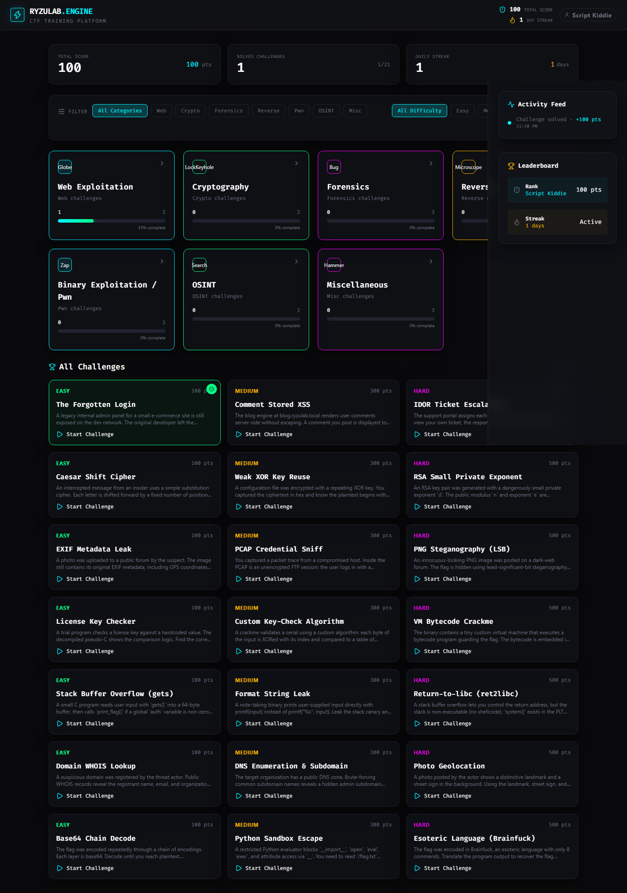

# RyzuLab — CTF Training Platform

A gamified Cybersecurity Capture The Flag (CTF) training platform with a cyberpunk / hacker terminal aesthetic. Built with **React (Vite) + Tailwind CSS + Zustand + Supabase**.

Live: **https://RyzuLabs.vercel.app**



## Features

- **7 CTF categories**, **21 challenges** (3 per category across Easy / Medium / Hard)
- **Cyberpunk terminal UI** — dark mode, neon cyan/green accents, monospace fonts, glassmorphism cards, scanline overlay
- **Challenge player modal** — backstory, objective, syntax-highlighted code artifacts with copy button, collapsible hints, flag input with instant feedback (success glow / error shake)
- **Username-only accounts** — no email. Register with a username + password; the app maps it to a private Supabase auth identity behind the scenes.
- **Per-user isolated progress** — scores, solves and streaks live in Supabase behind Row-Level Security, so each account only ever sees its own data.
- **Server-side scoring** — solving a challenge calls a `SECURITY DEFINER` RPC, so points can't be spoofed from the browser.
- **Global leaderboard** — top 10 ranked by score, refreshed live.
- **Admin dashboard** — admins can monitor every user, their score, streak, last solve and join date; search and sort highest → lowest.
- **Rank progression** — Script Kiddie → Cyber Ninja → Elite Hacker → Grandmaster
- **Daily streak tracker** with rollover logic and duplicate-solve protection
- Fully responsive

## Categories

| # | Category | Difficulty spread |
|---|----------|-------------------|
| 1 | Web Exploitation | SQLi, Stored XSS, IDOR |
| 2 | Cryptography | Caesar, XOR key reuse, RSA Wiener |
| 3 | Forensics | EXIF, PCAP, LSB steganography |
| 4 | Reverse Engineering | License check, key-gen, VM bytecode |
| 5 | Binary Exploitation / Pwn | Stack BOF, format string, ret2libc |
| 6 | OSINT | WHOIS, DNS enum, geolocation |
| 7 | Misc | Base64 chain, Python sandbox, Brainfuck |

## 1. Configure credentials

Copy `.env.example` to `.env` and fill in the two values from
Supabase → **Project Settings → API**:

```
VITE_SUPABASE_URL=https://<your-ref>.supabase.co
VITE_SUPABASE_ANON_KEY=<your-anon-key>
```

`.env` is git-ignored; no secrets are hardcoded in the source. The app throws a
clear error at startup if either variable is missing.

## 2. Set up Supabase (one time)

1. Open your Supabase project → **SQL Editor**.
2. Paste the entire contents of [`supabase/schema.sql`](supabase/schema.sql) and click **Run**.
   This creates `profiles`, `solves`, the `record_solve` RPC, RLS policies and the
   `get_leaderboard` RPC. Full step-by-step SQL is in [`DEPLOY.md`](DEPLOY.md).
3. Create an account in the app, then promote yourself to admin (SQL Editor):

   ```sql
   update public.profiles set is_admin = true where username = 'your_username';
   ```

4. The **Admin** button appears in the header. It opens the monitoring dashboard.

> **Email confirmation:** required to be **off** so username-only signup returns a session immediately.
> Supabase Dashboard → **Authentication → Providers → Email** → disable *Confirm email*.

## 3. Run locally

```bash
npm install
npm run dev      # http://localhost:5173
```

Production build:

```bash
npm run build
npm run preview
```

## 4. Deploy to Vercel

The repo ships with `vercel.json` (Vite framework preset, SPA rewrite, immutable asset caching).

1. Push this repo to GitHub: `Ryhandd/RyzuLab`.
2. Go to [vercel.com/new](https://vercel.com/new) → **Import Git Repository** → pick `Ryhandd/RyzuLab`.
3. Framework preset: **Vite**. Build command `npm run build`, output `dist` (auto-detected).
4. **Required:** add `VITE_SUPABASE_URL` and `VITE_SUPABASE_ANON_KEY` under
   **Environment Variables** (Production, Preview, Development). The build fails with
   *"Missing Supabase config"* without them — secrets are never baked into the source.
5. **Deploy**, then open **Settings → General → Project Name** and set it to `RyzuLabs` so it resolves at
   **https://RyzuLabs.vercel.app**.

Full step-by-step instructions, SQL commands and troubleshooting: [`DEPLOY.md`](DEPLOY.md).

## Project structure

```
src/
  App.jsx                     # auth gate + Header + Dashboard/Admin + modal + sidebar
  index.css                   # Tailwind directives + cyberpunk utilities
  lib/
    supabase.js               # Supabase client, username→email mapping, validators
  data/
    categories.js             # 7 categories, difficulties, rank thresholds
    challenges.js             # 21-challenge bank with flags + artifacts
  store/
    useAuth.js                # session/profile/solves store + auth actions + RPC calls
  components/
    AuthScreen.jsx            # username/password login + register
    Header.jsx                # logo, score/streak/rank, user menu, admin button
    Dashboard.jsx             # stats, filters, category grid, challenge grid
    AdminDashboard.jsx        # user monitoring table, search + sorting
    GlobalLeaderboard.jsx     # top 10 from Supabase
    CategoryCard.jsx          # category progress card
    ChallengeCard.jsx         # challenge tile
    ChallengeModal.jsx        # briefing/challenge tabs, hint, footer
    CodeArtifact.jsx          # code block with copy button
    FlagForm.jsx              # RYZU{...} flag input + validation
    ActivityFeed.jsx          # recent solves
    Leaderboard.jsx           # rank + streak summary
    useToast.jsx              # toast hook + container
supabase/
  schema.sql                  # tables, trigger, RPC, RLS, leaderboard view
```

## Notes

- Flags use the `RYZU{...}` format. They live in the challenge bank and are verified on submission; solving a
  new challenge calls `record_solve()` which awards points **once** per user.
- The dev server config restricts JSX transformation to `.jsx`/`.tsx` so data files in `.js` parse as plain JavaScript.
- Tailwind CSS v3 is used (not v4) so the classic `@tailwind` directives and `tailwind.config.js` theme apply.
